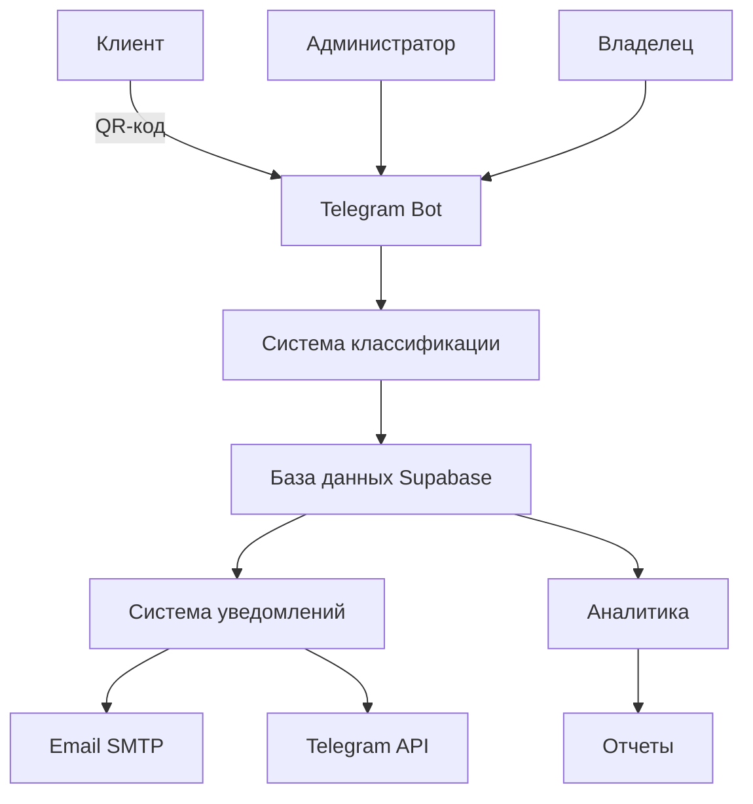
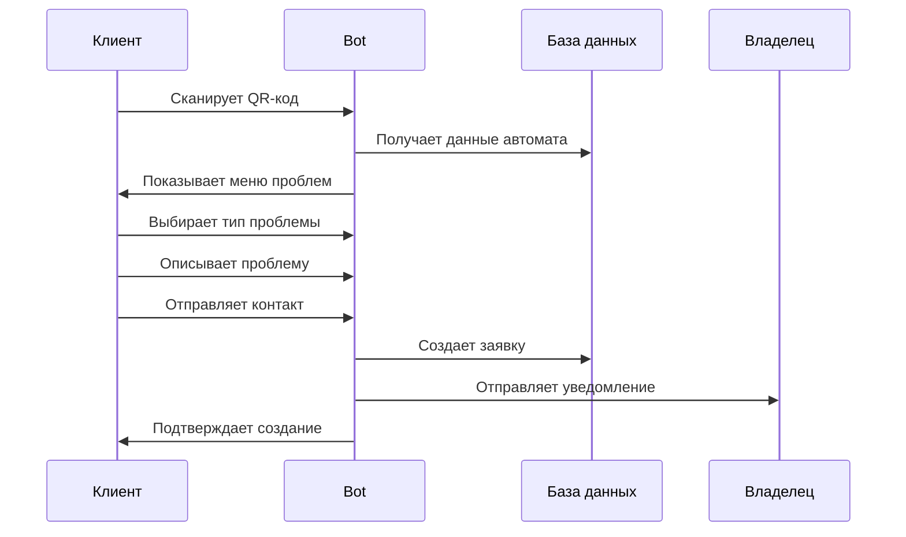
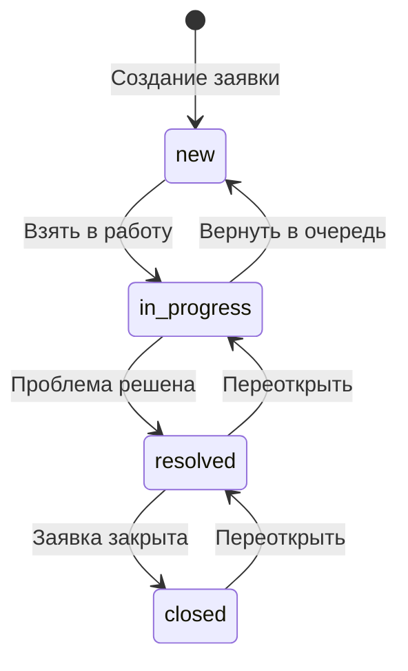
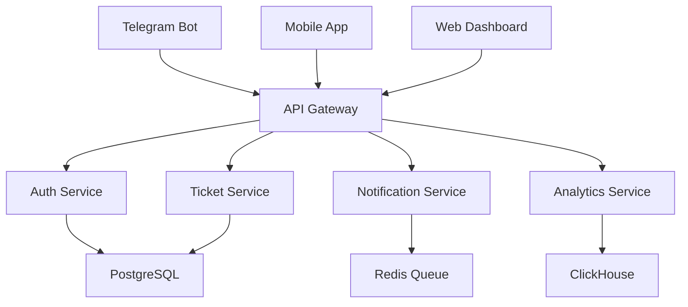

# 📋 Система управления заявками ЧистаВода
## Полная техническая документация

---

## 📖 Оглавление

1. [Общий обзор системы](#общий-обзор-системы)
2. [Архитектура системы](#архитектура-системы)
3. [Пользовательские роли](#пользовательские-роли)
4. [Жизненный цикл заявки](#жизненный-цикл-заявки)
5. [Система уведомлений](#система-уведомлений)
6. [Техническая реализация](#техническая-реализация)
7. [База данных](#база-данных)
8. [Настройка и развертывание](#настройка-и-развертывание)
9. [Руководство пользователя](#руководство-пользователя)
10. [Администрирование](#администрирование)
11. [API и интеграции](#api-и-интеграции)
12. [Безопасность](#безопасность)
13. [Мониторинг и логирование](#мониторинг-и-логирование)
14. [Troubleshooting](#troubleshooting)
15. [Планы развития](#планы-развития)

---

## 🎯 Общий обзор системы

### Назначение
Система управления заявками ЧистаВода предназначена для автоматизации процесса обработки обращений клиентов по проблемам с терминалами розлива воды.

### Ключевые возможности
- ✅ **Создание заявок** через QR-коды на автоматах
- ✅ **Трехуровневая категоризация** проблем (60+ типов)
- ✅ **Автоматическое уведомление** владельцев по Email и Telegram
- ✅ **Управление статусами** заявок администраторами и владельцами
- ✅ **Отслеживание статуса** клиентами в реальном времени
- ✅ **Аналитика и отчетность** по заявкам
- ✅ **Многоуровневая система прав** доступа

### Основные метрики
- 📊 **Время обработки заявки:** в среднем 2-4 часа
- 📈 **Автоматизация:** 95% процессов
- 🎯 **Точность категоризации:** 60+ конкретных типов проблем
- 📱 **Каналы уведомлений:** Telegram, Email
- 🔐 **Уровни доступа:** 3 (Клиент, Владелец, Администратор)

---

## 🏗️ Архитектура системы

### Компоненты системы



### Технологический стек
- **Backend:** Python 3.9+, python-telegram-bot
- **База данных:** PostgreSQL (Supabase)
- **Уведомления:** SMTP (Gmail), Telegram Bot API
- **Логирование:** Python logging, JSON структура
- **Мониторинг:** psutil для системных метрик

### Основные модули
```python
├── main.py                 # Основной файл бота
├── texts.json             # Тексты интерфейса
├── config/
│   ├── database.py        # Настройки БД
│   └── notifications.py   # Настройки уведомлений
├── handlers/
│   ├── admin.py          # Административные функции
│   ├── owner.py          # Функции владельцев
│   └── client.py         # Клиентские функции
├── models/
│   ├── ticket.py         # Модель заявки
│   ├── machine.py        # Модель автомата
│   └── user.py           # Модель пользователя
├── services/
│   ├── notification.py   # Сервис уведомлений
│   ├── analytics.py      # Аналитика
│   └── validation.py     # Валидация данных
└── utils/
    ├── logger.py         # Система логирования
    └── helpers.py        # Вспомогательные функции
```

---

## 👥 Пользовательские роли

### 1. 👤 Клиент
**Права доступа:**
- Создание заявок через QR-код
- Просмотр статуса своих заявок
- Получение уведомлений о изменениях
- Оценка качества обслуживания

**Ограничения:**
- Нет доступа к заявкам других клиентов
- Нельзя изменять статусы заявок
- Нет доступа к административным функциям

### 2. 🏪 Владелец автомата
**Права доступа:**
- Просмотр заявок по своим автоматам
- Изменение статусов заявок (new → in_progress → resolved → closed)
- Добавление комментариев к заявкам
- Просмотр статистики по своим автоматам
- Управление списком своих автоматов
- Отправка уведомлений клиентам

**Ограничения:**
- Нет доступа к заявкам других владельцев
- Нет доступа к системной аналитике
- Нельзя удалять заявки

**Доступ:** `/start owner`

### 3. 🔧 Администратор
**Права доступа:**
- Полный доступ ко всем заявкам системы
- Изменение любых статусов заявок
- Управление пользователями (владельцами)
- Просмотр системной аналитики
- Поиск заявок по всем параметрам
- Управление автоматами
- Доступ к логам системы

**Доступ:** `/start admin`

### Матрица прав доступа

| Функция | Клиент | Владелец | Администратор |
|---------|---------|-----------|---------------|
| Создание заявки | ✅ | ✅ | ✅ |
| Просмотр своих заявок | ✅ | ✅ | ✅ |
| Просмотр чужих заявок | ❌ | ❌ | ✅ |
| Изменение статуса | ❌ | ✅* | ✅ |
| Добавление комментариев | ❌ | ✅ | ✅ |
| Системная аналитика | ❌ | ❌ | ✅ |
| Управление пользователями | ❌ | ❌ | ✅ |
| Поиск заявок | ❌ | ✅* | ✅ |

*\* Только по своим автоматам*

---

## 🔄 Жизненный цикл заявки

### 1. 📱 Создание заявки

#### Процесс создания:


#### Обязательные поля:
- `ticket_number` - уникальный номер (ST-YYYY-NNNN)
- `user_id` - Telegram ID клиента
- `user_name` - имя клиента
- `user_phone` - телефон клиента
- `machine_id` - ID автомата
- `problem_type` - тип проблемы
- `status` - статус заявки (по умолчанию 'new')

#### Опциональные поля:
- `problem_description` - описание проблемы
- `problem_subcategory` - подкатегория
- `problem_level3` - конкретная проблема
- `priority` - приоритет (по умолчанию 'normal')

### 2. 📊 Статусы заявок

#### Доступные статусы:
- 🆕 **new** - Новая заявка (по умолчанию)
- ⏳ **in_progress** - В работе
- ✅ **resolved** - Решена
- 🔒 **closed** - Закрыта

#### Переходы между статусами:


#### Правила изменения статусов:
1. **Автоматические изменения:**
   - При создании → `new`
   - При установке `resolved`/`closed` → обновляется `resolved_at`

2. **Ручные изменения:**
   - Владелец: может изменять статусы своих заявок
   - Администратор: может изменять любые статусы

### 3. 📈 Приоритеты заявок

| Приоритет | Emoji | Описание | Время реакции |
|-----------|-------|----------|---------------|
| `low` | 🟢 | Низкий | 24 часа |
| `normal` | 🟡 | Обычный | 8 часов |
| `high` | 🟠 | Высокий | 2 часа |
| `urgent` | 🔴 | Критический | 30 минут |

### 4. 📝 Комментарии и история

#### Структура комментариев:
```
[DD.MM.YYYY HH:MM] Имя Пользователя: Текст комментария
[16.08.2025 14:30] Олександр Дзонь: Взяв заявку в роботу
[16.08.2025 15:45] Адмін Система: Статус змінено на "Вирішена"
```

#### Автоматические записи:
- Изменение статуса
- Назначение исполнителя
- Изменение приоритета

---

## 📧 Система уведомлений

### Каналы уведомлений

#### 1. 📱 Telegram уведомления

**Клиентам при изменении статуса:**
```
📋 ОНОВЛЕННЯ ЗАЯВКИ #ST-2025-0005

✅ Ваша заявка вирішена!
Проблема усунена. Дякуємо за звернення!

📍 Автомат: Київ, вул. Бажана, 26
🔧 Проблема: 💳 Проблема з оплатою

📊 Було: В роботі ⏳
📊 Стало: Вирішена ✅

💬 Коментар спеціаліста:
Замінено монетоприймач

🕐 Час оновлення: 16.08.2025 14:30

⭐ Оцініть якість обслуговування:
Відповідь на це повідомлення цифрою від 1 до 5
```

#### 2. 📧 Email уведомления

**Владельцам при создании/изменении заявок:**

**Тема:** `🚨 Нова заявка #ST-2025-0005` или `📊 Зміна статусу заявки #ST-2025-0005`

**Содержание:**
```html
<!DOCTYPE html>
<html>
<head>
    <meta charset="UTF-8">
    <title>Уведомление ЧистаВода</title>
</head>
<body style="font-family: Arial, sans-serif; max-width: 600px; margin: 0 auto;">
    <h2 style="color: #2196F3;">📊 Зміна статусу заявки</h2>
    
    <div style="background: #f5f5f5; padding: 15px; border-radius: 8px; margin: 15px 0;">
        <h3>📋 Інформація про заявку</h3>
        <p><strong>Номер заявки:</strong> #ST-2025-0005</p>
        <p><strong>Автомат:</strong> Київ, вул. Бажана, 26</p>
        <p><strong>Клієнт:</strong> Антон Андрухов</p>
        <p><strong>Телефон:</strong> +380506221811</p>
        <p><strong>Проблема:</strong> 💳 Проблема з оплатою → Не працює монетоприймач</p>
    </div>
    
    <div style="background: #e3f2fd; padding: 15px; border-radius: 8px; margin: 15px 0;">
        <h3>🔄 Зміна статусу</h3>
        <p><strong>Було:</strong> 🆕 Нова</p>
        <p><strong>Стало:</strong> ⏳ В роботі</p>
        <p><strong>Хто змінив:</strong> Олександр Дзонь</p>
        <p><strong>Час зміни:</strong> 16.08.2025 о 14:30</p>
    </div>
    
    <div style="background: #fff3e0; padding: 15px; border-radius: 8px; margin: 15px 0;">
        <h3>💬 Коментар</h3>
        <p>Взяв заявку в роботу, буду на місці через годину</p>
    </div>
    
    <hr style="margin: 20px 0;">
    <p style="color: #666; font-size: 12px;">
        Це автоматичне повідомлення системи управління заявками ЧистаВода.<br>
        Час відправки: 16.08.2025 14:30:25
    </p>
</body>
</html>
```

### Правила отправки уведомлений

#### Telegram уведомления клиентам:
- ✅ При изменении статуса заявки
- ✅ При добавлении комментария специалистом
- ✅ При решении заявки (с запросом оценки)
- ❌ При технических изменениях (обновление временных меток и т.д.)

#### Email уведомления владельцам:
- ✅ При создании новой заявки
- ✅ При изменении статуса заявки
- ✅ При добавлении комментария к заявке
- ✅ При назначении заявки

#### Настройки уведомлений:
```python
# В .env файле
EMAIL_ENABLED=true                    # Включить Email уведомления
TELEGRAM_NOTIFICATIONS_ENABLED=true   # Включить Telegram уведомления
NOTIFICATION_RETRY_COUNT=3            # Количество попыток отправки
NOTIFICATION_RETRY_DELAY=5            # Задержка между попытками (сек)
```

---

## ⚙️ Техническая реализация

### Структура кода

#### Основные классы и функции:

**1. Управление заявками:**
```python
class TicketManager:
    def create_ticket(self, user_data: dict) -> str
    def update_status(self, ticket_id: int, new_status: str) -> bool
    def add_comment(self, ticket_id: int, comment: str, user: User) -> bool
    def search_tickets(self, filters: dict) -> List[dict]
    def get_ticket_by_id(self, ticket_id: int) -> dict
```

**2. Система уведомлений:**
```python
class NotificationService:
    def send_email(self, to: str, subject: str, body: str) -> bool
    def send_telegram(self, user_id: int, message: str) -> bool
    def notify_status_change(self, ticket: dict, old_status: str, new_status: str)
    def notify_new_ticket(self, ticket: dict)
```

**3. Управление пользователями:**
```python
class UserManager:
    def is_admin(self, user_id: int) -> bool
    def is_owner(self, user_id: int) -> bool
    def get_owner_by_telegram_id(self, telegram_id: int) -> dict
    def get_owner_machines(self, owner_id: int) -> List[dict]
```

### Архитектурные паттерны

#### 1. MVC (Model-View-Controller)
- **Model:** Supabase таблицы и ORM
- **View:** Telegram интерфейс (клавиатуры, сообщения)
- **Controller:** Обработчики команд и сообщений

#### 2. Service Layer
```python
# Разделение бизнес-логики и представления
class TicketService:
    def __init__(self, db_client, notification_service):
        self.db = db_client
        self.notifications = notification_service
    
    def process_new_ticket(self, ticket_data):
        # Бизнес-логика создания заявки
        ticket_id = self.db.create_ticket(ticket_data)
        self.notifications.notify_new_ticket(ticket_data)
        return ticket_id
```

#### 3. Repository Pattern
```python
class TicketRepository:
    def __init__(self, supabase_client):
        self.client = supabase_client
    
    def find_by_status(self, status: str) -> List[dict]:
        return self.client.table("support_tickets")\
            .select("*")\
            .eq("status", status)\
            .execute().data
```

### Система логирования

#### Конфигурация логгера:
```python
import logging
import json
from datetime import datetime

class StructuredLogger:
    def __init__(self):
        self.logger = logging.getLogger("chistavoda_bot")
        handler = logging.FileHandler("logs/bot.log")
        handler.setFormatter(JsonFormatter())
        self.logger.addHandler(handler)
        self.logger.setLevel(logging.INFO)
    
    def log_action(self, action: str, user_id: int, details: dict):
        log_data = {
            "timestamp": datetime.now().isoformat(),
            "action": action,
            "user_id": user_id,
            "details": details
        }
        self.logger.info(json.dumps(log_data, ensure_ascii=False))
```

#### Типы логов:
- **USER_ACTION:** Действия пользователей
- **DB_OPERATION:** Операции с БД
- **NOTIFICATION:** Отправка уведомлений
- **ERROR:** Ошибки системы
- **PERFORMANCE:** Метрики производительности

---

## 🗄️ База данных

### Схема базы данных

#### Основные таблицы:

**1. support_tickets** - заявки
```sql
CREATE TABLE support_tickets (
    id SERIAL PRIMARY KEY,
    ticket_number VARCHAR(20) UNIQUE NOT NULL,
    user_id BIGINT NOT NULL,
    user_name VARCHAR(255),
    user_phone VARCHAR(20) NOT NULL,
    problem_type VARCHAR(100) NOT NULL,
    problem_subcategory VARCHAR(100),
    problem_level3 VARCHAR(100),
    problem_description TEXT,
    machine_id UUID NOT NULL REFERENCES machines(id),
    status VARCHAR(20) DEFAULT 'new',
    priority VARCHAR(10) DEFAULT 'normal',
    assigned_to INTEGER REFERENCES owners(owner_id),
    resolution_notes TEXT,
    created_at TIMESTAMPTZ DEFAULT NOW(),
    updated_at TIMESTAMPTZ DEFAULT NOW(),
    resolved_at TIMESTAMPTZ,
    client_rating INTEGER CHECK (client_rating >= 1 AND client_rating <= 5),
    severity_level VARCHAR(20) DEFAULT 'normal'
);
```

**2. machines** - автоматы
```sql
CREATE TABLE machines (
    id UUID PRIMARY KEY DEFAULT gen_random_uuid(),
    code VARCHAR(20) UNIQUE NOT NULL,
    owner_id INTEGER REFERENCES owners(owner_id),
    region VARCHAR(100) NOT NULL,
    street VARCHAR(100) NOT NULL,
    building_number VARCHAR(20) NOT NULL,
    details TEXT,
    installation_date DATE,
    status VARCHAR(20) DEFAULT 'active',
    qr_code_url TEXT,
    notes TEXT,
    created_at TIMESTAMPTZ DEFAULT NOW(),
    updated_at TIMESTAMPTZ DEFAULT NOW()
);
```

**3. owners** - владельцы автоматов
```sql
CREATE TABLE owners (
    owner_id SERIAL PRIMARY KEY,
    telegram_user_id BIGINT UNIQUE,
    first_name VARCHAR(100) NOT NULL,
    last_name VARCHAR(100),
    patronymic VARCHAR(100),
    ownership_form VARCHAR(50),
    mobile_phone VARCHAR(20),
    phone VARCHAR(20),
    email VARCHAR(100),
    residence_address TEXT,
    created_at TIMESTAMPTZ DEFAULT NOW(),
    updated_at TIMESTAMPTZ DEFAULT NOW()
);
```

**4. notification_log** - лог уведомлений
```sql
CREATE TABLE notification_log (
    id SERIAL PRIMARY KEY,
    ticket_id INTEGER REFERENCES support_tickets(id),
    notification_type VARCHAR(50) NOT NULL, -- 'email', 'telegram'
    recipient VARCHAR(255) NOT NULL,
    subject VARCHAR(255),
    content TEXT,
    status VARCHAR(20) DEFAULT 'pending', -- 'sent', 'failed', 'pending'
    error_message TEXT,
    created_at TIMESTAMPTZ DEFAULT NOW(),
    sent_at TIMESTAMPTZ
);
```

### Индексы для производительности

```sql
-- Основные индексы
CREATE INDEX idx_support_tickets_created_at ON support_tickets(created_at DESC);
CREATE INDEX idx_support_tickets_machine_id ON support_tickets(machine_id);
CREATE INDEX idx_support_tickets_status ON support_tickets(status);
CREATE INDEX idx_support_tickets_user_id ON support_tickets(user_id);
CREATE INDEX idx_support_tickets_assigned_to ON support_tickets(assigned_to);
CREATE INDEX idx_support_tickets_ticket_number ON support_tickets(ticket_number);

-- Составные индексы
CREATE INDEX idx_tickets_status_created ON support_tickets(status, created_at DESC);
CREATE INDEX idx_tickets_machine_status ON support_tickets(machine_id, status);

-- Индексы для владельцев
CREATE INDEX idx_owners_telegram_user_id ON owners(telegram_user_id);
CREATE INDEX idx_machines_owner_id ON machines(owner_id);
```

### Представления (Views) для аналитики

**1. owner_ticket_statistics** - статистика по владельцам
```sql
CREATE VIEW owner_ticket_statistics AS
SELECT 
    o.owner_id,
    o.first_name,
    o.last_name,
    o.email,
    COUNT(st.id) as total_tickets,
    COUNT(CASE WHEN st.status = 'new' THEN 1 END) as new_tickets,
    COUNT(CASE WHEN st.status = 'in_progress' THEN 1 END) as in_progress_tickets,
    COUNT(CASE WHEN st.status = 'resolved' THEN 1 END) as resolved_tickets,
    COUNT(CASE WHEN st.status = 'closed' THEN 1 END) as closed_tickets,
    ROUND(AVG(st.client_rating), 2) as avg_rating,
    COUNT(DISTINCT m.id) as machines_count,
    MAX(st.created_at) as last_ticket_date
FROM owners o
LEFT JOIN machines m ON o.owner_id = m.owner_id
LEFT JOIN support_tickets st ON m.id = st.machine_id
GROUP BY o.owner_id, o.first_name, o.last_name, o.email;
```

**2. machine_problem_statistics** - статистика по автоматам
```sql
CREATE VIEW machine_problem_statistics AS
SELECT 
    m.id as machine_id,
    m.code,
    m.region,
    m.street,
    m.building_number,
    CONCAT(m.region, ', вул. ', m.street, ', ', m.building_number) as full_address,
    m.status as machine_status,
    COUNT(st.id) as total_tickets,
    COUNT(CASE WHEN st.problem_type = 'machine_offline' THEN 1 END) as offline_issues,
    COUNT(CASE WHEN st.problem_type = 'payment_issue' THEN 1 END) as payment_issues,
    COUNT(CASE WHEN st.problem_type = 'water_quality' THEN 1 END) as water_quality_issues,
    ROUND(AVG(st.client_rating), 2) as avg_rating,
    MAX(st.created_at) as last_ticket_date
FROM machines m
LEFT JOIN support_tickets st ON m.id = st.machine_id
GROUP BY m.id, m.code, m.region, m.street, m.building_number, m.status;
```

### Функции БД

**1. Генерация номера заявки**
```sql
CREATE OR REPLACE FUNCTION generate_ticket_number()
RETURNS TEXT AS $$
DECLARE
    year_part TEXT;
    last_number INTEGER;
    new_number INTEGER;
BEGIN
    year_part := EXTRACT(YEAR FROM NOW())::TEXT;
    
    SELECT COALESCE(MAX(
        CAST(SPLIT_PART(ticket_number, '-', 3) AS INTEGER)
    ), 0) INTO last_number
    FROM support_tickets 
    WHERE ticket_number LIKE 'ST-' || year_part || '-%';
    
    new_number := last_number + 1;
    
    RETURN 'ST-' || year_part || '-' || LPAD(new_number::TEXT, 4, '0');
END;
$$ LANGUAGE plpgsql;
```

**2. Автоматическое обновление updated_at**
```sql
CREATE OR REPLACE FUNCTION update_updated_at_column()
RETURNS TRIGGER AS $$
BEGIN
    NEW.updated_at = NOW();
    RETURN NEW;
END;
$$ LANGUAGE plpgsql;

-- Применяем к таблицам
CREATE TRIGGER update_support_tickets_updated_at 
    BEFORE UPDATE ON support_tickets 
    FOR EACH ROW EXECUTE FUNCTION update_updated_at_column();

CREATE TRIGGER update_machines_updated_at 
    BEFORE UPDATE ON machines 
    FOR EACH ROW EXECUTE FUNCTION update_updated_at_column();
```

---

## 🚀 Настройка и развертывание

### Требования к системе

#### Минимальные требования:
- **ОС:** Linux Ubuntu 20.04+ / CentOS 8+ / Windows 10+
- **Python:** 3.9+
- **RAM:** 512 MB
- **Диск:** 2 GB свободного места
- **Сеть:** Интернет соединение

#### Рекомендуемые требования:
- **ОС:** Linux Ubuntu 22.04 LTS
- **Python:** 3.11+
- **RAM:** 2 GB
- **Диск:** 10 GB SSD
- **CPU:** 2 cores

### Установка и настройка

#### 1. Клонирование репозитория
```bash
git clone https://github.com/your-repo/chistavoda-bot.git
cd chistavoda-bot
```

#### 2. Создание виртуального окружения
```bash
python3 -m venv venv
source venv/bin/activate  # Linux/Mac
# или
venv\Scripts\activate     # Windows
```

#### 3. Установка зависимостей
```bash
pip install -r requirements.txt
```

**requirements.txt:**
```
python-telegram-bot==20.7
supabase==1.0.3
python-dotenv==1.0.0
psutil==5.9.0
smtplib
email-validator==2.0.0
asyncio
aiohttp==3.8.5
```

#### 4. Настройка переменных окружения

Создайте файл `.env`:
```env
# Telegram Bot
TELEGRAM_BOT_TOKEN=1234567890:ABCdefGHIjklMNOpqrsTUVwxyz

# Supabase
SUPABASE_URL=https://your-project.supabase.co
SUPABASE_ANON_KEY=your-anon-key
SUPABASE_SERVICE_KEY=your-service-key

# Email настройки
EMAIL_ENABLED=true
SMTP_SERVER=smtp.gmail.com
SMTP_PORT=587
SMTP_USERNAME=your-email@gmail.com
SMTP_PASSWORD=your-app-password

# Пользователи
ADMIN_USER_IDS=123456789,987654321
OWNER_USER_IDS=111222333,444555666

# Экстренные контакты
EMERGENCY_PHONE=050-777-30-15
SUPPORT_EMAIL=support@chistavoda.ua

# Логирование
LOG_LEVEL=INFO
LOG_FILE_SIZE=10MB
LOG_BACKUP_COUNT=5

# Мониторинг
METRICS_ENABLED=true
METRICS_INTERVAL=300

# Уведомления
NOTIFICATION_RETRY_COUNT=3
NOTIFICATION_RETRY_DELAY=5
TELEGRAM_NOTIFICATIONS_ENABLED=true
```

#### 5. Настройка базы данных

**5.1. Создание проекта в Supabase:**
1. Зайдите на https://supabase.com
2. Создайте новый проект
3. Скопируйте URL и API ключи

**5.2. Выполнение миграций:**
```sql
-- Создание таблиц (выполнить в Supabase SQL Editor)
-- Код таблиц из раздела "База данных"
```

**5.3. Настройка RLS (Row Level Security):**
```sql
-- Включаем RLS для всех таблиц
ALTER TABLE support_tickets ENABLE ROW LEVEL SECURITY;
ALTER TABLE machines ENABLE ROW LEVEL SECURITY;
ALTER TABLE owners ENABLE ROW LEVEL SECURITY;

-- Политики безопасности
CREATE POLICY "Users can view their own tickets" ON support_tickets
    FOR SELECT USING (user_id = auth.uid()::bigint);

CREATE POLICY "Owners can view their machine tickets" ON support_tickets
    FOR SELECT USING (
        machine_id IN (
            SELECT id FROM machines WHERE owner_id IN (
                SELECT owner_id FROM owners WHERE telegram_user_id = auth.uid()::bigint
            )
        )
    );
```

#### 6. Настройка Gmail для email уведомлений

**6.1. Включение 2FA:**
1. Зайдите в настройки Google аккаунта
2. Безопасность → Двухэтапная аутентификация
3. Включите 2FA

**6.2. Создание App Password:**
1. Настройки Google → Безопасность
2. Пароли приложений
3. Выберите "Почта"
4. Сгенерируйте пароль
5. Используйте этот пароль в `SMTP_PASSWORD`

#### 7. Создание Telegram бота

**7.1. Регистрация бота:**
1. Найдите @BotFather в Telegram
2. Отправьте `/newbot`
3. Укажите имя и username бота
4. Скопируйте токен в `TELEGRAM_BOT_TOKEN`

**7.2. Настройка команд бота:**
```
start - Почати роботу з ботом
help - Довідка та підтримка
status - Статус заявки
```

### Запуск системы

#### 1. Проверка конфигурации
```bash
python -c "from main import PreStartupSystem; PreStartupSystem.run_all_checks()"
```

#### 2. Запуск в режиме разработки
```bash
python main.py
```

#### 3. Запуск в production

**3.1. Создание systemd сервиса (Linux):**
```ini
# /etc/systemd/system/chistavoda-bot.service
[Unit]
Description=ChistaVoda Telegram Bot
After=network.target

[Service]
Type=simple
User=chistavoda
WorkingDirectory=/opt/chistavoda-bot
Environment=PATH=/opt/chistavoda-bot/venv/bin
ExecStart=/opt/chistavoda-bot/venv/bin/python main.py
Restart=always
RestartSec=10

[Install]
WantedBy=multi-user.target
```

**3.2. Запуск сервиса:**
```bash
sudo systemctl daemon-reload
sudo systemctl enable chistavoda-bot
sudo systemctl start chistavoda-bot
sudo systemctl status chistavoda-bot
```

**3.3. Просмотр логов:**
```bash
sudo journalctl -u chistavoda-bot -f
```

### Docker развертывание

#### Dockerfile:
```dockerfile
FROM python:3.11-slim

WORKDIR /app

COPY requirements.txt .
RUN pip install --no-cache-dir -r requirements.txt

COPY . .

CMD ["python", "main.py"]
```

#### docker-compose.yml:
```yaml
version: '3.8'

services:
  chistavoda-bot:
    build: .
    restart: unless-stopped
    env_file:
      - .env
    volumes:
      - ./logs:/app/logs
      - ./data:/app/data
    depends_on:
      - redis
    networks:
      - chistavoda-network

  redis:
    image: redis:7-alpine
    restart: unless-stopped
    volumes:
      - redis_data:/data
    networks:
      - chistavoda-network

volumes:
  redis_data:

networks:
  chistavoda-network:
    driver: bridge
```

#### Запуск с Docker:
```bash
docker-compose up -d
docker-compose logs -f chistavoda-bot
```

---

## 👨‍💻 Руководство пользователя

### Для клиентов

#### 1. Создание заявки
1. **Сканирование QR-кода:**
   - Найдите QR-код на автомате
   - Отсканируйте его камерой телефона
   - Перейдите по ссылке в Telegram

2. **Выбор типа проблемы:**
   ```
   🚫 Автомат не працює
   💳 Проблема з оплатою  
   💦 Погана якість води
   🔧 Інша технічна проблема
   💧 Інформація про якість води
   📞 Екстрена допомога
   ```

3. **Уточнение проблемы:**
   - Выберите подкатегорию проблемы
   - При необходимости выберите конкретную проблему
   - Опишите проблему своими словами (необязательно)

4. **Отправка контактных данных:**
   - Нажмите "📞 Надіслати номер телефону"
   - Бот автоматически получит ваш номер

5. **Подтверждение:**
   - Заявка создана!
   - Вы получите номер заявки
   - Владелец автомата получит уведомление

#### 2. Отслеживание статуса заявки
- Бот автоматически присылает уведомления при изменении статуса
- Статусы заявок:
  - 🆕 **Нова** - заявка создана
  - ⏳ **В роботі** - специалист работает над проблемой
  - ✅ **Вирішена** - проблема решена
  - 🔒 **Закрита** - заявка закрыта

#### 3. Оценка качества обслуживания
- После решения заявки бот попросит оценить качество
- Отправьте цифру от 1 до 5:
  - 1 - очень плохо
  - 2 - плохо  
  - 3 - нормально
  - 4 - хорошо
  - 5 - отлично

### Для владельцев автоматов

#### 1. Доступ к системе
```
/start owner
```

#### 2. Главное меню владельца
```
[📋 Мої заявки] [🆕 Нові заявки]
[📊 Статистика] [🏪 Мої автомати]  
[🔙 Вийти]
```

#### 3. Просмотр заявок
- **Все заявки:** полный список заявок по вашим автоматам
- **Новые заявки:** только заявки со статусом "Нова"
- Для каждой заявки отображается:
  - Номер заявки
  - Дата создания
  - Данные клиента
  - Тип проблемы
  - Статус и приоритет

#### 4. Управление заявкой
1. Выберите заявку из списка
2. Доступные действия:
   ```
   [⏳ Взяти в роботу]    (если статус "Нова")
   [✅ Позначити вирішеною]  (если статус "В роботі")
   [🔒 Закрити заявку]   (если статус "Вирішена")
   [💬 Додати коментар]
   [📧 Повідомити клієнта]
   ```

#### 5. Добавление комментариев
- Комментарии помогают отслеживать ход работы
- Клиент получает уведомление о новых комментариях
- Комментарии сохраняются в истории заявки

#### 6. Статистика
Показывает:
- Количество ваших автоматов
- Общее количество заявок
- Распределение по статусам
- Распределение по приоритетам  
- Заявки за последний месяц
- Процент завершенных заявок

### Для администраторов

#### 1. Доступ к админ-панели
```
/start admin
```

#### 2. Главное меню администратора
```
[👥 Список власників] [📊 Статистика] [📋 Останні заявки]
[➕ Додати власника] [❌ Видалити власника]
[🔙 Назад]
```

#### 3. Управление заявками
- **Последние заявки:** показывает 10 последних заявок
- **Управление заявками:** расширенное меню:
  ```
  [🆕 Нові заявки] [⏳ В роботі] [✅ Вирішені]
  [📊 Статистика заявок] [🔍 Знайти заявку]
  ```

#### 4. Поиск заявок
- Поиск по точному номеру: `ST-2025-0005`
- Частичный поиск: `0005` или `ST-2025`
- Результат: список найденных заявок

#### 5. Детальное управление заявкой
После выбора заявки доступно:
```
[➤ Змінити на: ⏳ В роботі]
[➤ Змінити на: ✅ Вирішена]  
[➤ Змінити на: 🔒 Закрита]
[💬 Додати коментар]
[📧 Повідомити клієнта]
```

#### 6. Управление владельцами
- **Список владельцев:** показывает всех зарегистрированных владельцев
- **Добавление владельца:**
  1. Введите ФИО
  2. Введите номер телефона  
  3. Введите email
  4. Владелец добавлен в систему
- **Удаление владельца:** выберите из списка

#### 7. Системная статистика
Показывает:
- Общее количество заявок
- Распределение по статусам
- Распределение по приоритетам
- Заявки за последнюю неделю
- Количество автоматов и владельцев
- Процент завершенных заявок

---

## 🔧 Администрирование

### Мониторинг системы

#### 1. Системные метрики
Система автоматически отслеживает:
- **CPU usage** - загрузка процессора
- **Memory usage** - использование оперативной памяти  
- **Disk usage** - использование дискового пространства
- **Network activity** - сетевая активность

#### 2. Метрики приложения
- **Количество активных пользователей**
- **Заявки в день/час**
- **Время ответа базы данных**
- **Успешность отправки уведомлений**
- **Ошибки в логах**

#### 3. Алерты и уведомления
Настройте уведомления администраторов при:
- Высокой загрузке системы (CPU > 80%)
- Нехватке памяти (RAM > 90%)
- Ошибках базы данных
- Неудачных отправках email (> 10% в час)
- Недоступности внешних сервисов

### Резервное копирование

#### 1. База данных
```bash
# Создание резервной копии
pg_dump -h your-supabase-host -U postgres your-db-name > backup_$(date +%Y%m%d_%H%M%S).sql

# Восстановление
psql -h your-supabase-host -U postgres your-db-name < backup_20250816_143000.sql
```

#### 2. Конфигурационные файлы
```bash
# Создание архива конфигурации
tar -czf config_backup_$(date +%Y%m%d).tar.gz .env texts.json logs/
```

#### 3. Автоматическое резервное копирование
**Cron задача (Linux):**
```bash
# Добавить в crontab (crontab -e)
0 2 * * * /opt/chistavoda-bot/scripts/backup.sh
```

**backup.sh:**
```bash
#!/bin/bash
BACKUP_DIR="/opt/backups/chistavoda"
DATE=$(date +%Y%m%d_%H%M%S)

mkdir -p $BACKUP_DIR

# Резервная копия конфигурации
tar -czf $BACKUP_DIR/config_$DATE.tar.gz /opt/chistavoda-bot/.env /opt/chistavoda-bot/texts.json

# Резервная копия логов
tar -czf $BACKUP_DIR/logs_$DATE.tar.gz /opt/chistavoda-bot/logs/

# Удаление старых резервных копий (старше 30 дней)
find $BACKUP_DIR -name "*.tar.gz" -mtime +30 -delete
```

### Обновление системы

#### 1. Порядок обновления
```bash
# 1. Остановка сервиса
sudo systemctl stop chistavoda-bot

# 2. Резервная копия
./scripts/backup.sh

# 3. Обновление кода
git pull origin main

# 4. Обновление зависимостей
pip install -r requirements.txt --upgrade

# 5. Миграции БД (если есть)
python migrate.py

# 6. Запуск сервиса
sudo systemctl start chistavoda-bot

# 7. Проверка статуса
sudo systemctl status chistavoda-bot
```

#### 2. Откат при проблемах
```bash
# Откат кода
git reset --hard HEAD~1

# Восстановление БД из резервной копии
psql -h host -U user db_name < backup_before_update.sql

# Перезапуск сервиса
sudo systemctl restart chistavoda-bot
```

### Управление пользователями

#### 1. Добавление администратора
```env
# В .env файле
ADMIN_USER_IDS=123456789,987654321,new_admin_id
```

#### 2. Добавление владельца автомата
```sql
-- В БД
INSERT INTO owners (telegram_user_id, first_name, last_name, email, mobile_phone)
VALUES (111222333, 'Иван', 'Петренко', 'ivan@example.com', '+380501234567');
```

```env
# В .env файле
OWNER_USER_IDS=111222333,444555666,new_owner_id
```

#### 3. Получение Telegram ID пользователя
Попросите пользователя отправить боту команду `/start` и найдите его ID в логах:
```bash
grep "Пользователь запустил бота" logs/chistavoda_bot.log
```

### Настройка мониторинга

#### 1. Установка системы мониторинга
```bash
# Установка Prometheus и Grafana (пример для Ubuntu)
sudo apt-get update
sudo apt-get install prometheus grafana

# Настройка автозапуска
sudo systemctl enable prometheus grafana-server
sudo systemctl start prometheus grafana-server
```

#### 2. Метрики для отслеживания
- **Время отклика бота** (< 2 секунд)
- **Успешность создания заявок** (> 95%)
- **Доставка email уведомлений** (> 90%)
- **Доставка Telegram уведомлений** (> 95%)
- **Использование ресурсов сервера**

#### 3. Dashboard для мониторинга
Создайте dashboard в Grafana с панелями:
- Количество заявок в день
- Распределение по статусам  
- Время обработки заявок
- Нагрузка на сервер
- Статус отправки уведомлений

---

## 🔌 API и интеграции

### Supabase API

#### 1. Основные эндпоинты
```python
# Получение заявок
response = supabase.table("support_tickets")\
    .select("*")\
    .order("created_at", desc=True)\
    .limit(10)\
    .execute()

# Создание заявки
ticket_data = {
    "ticket_number": "ST-2025-0001",
    "user_id": 123456789,
    "machine_id": "uuid-here",
    "problem_type": "machine_offline"
}
response = supabase.table("support_tickets")\
    .insert(ticket_data)\
    .execute()

# Обновление статуса
response = supabase.table("support_tickets")\
    .update({"status": "resolved"})\
    .eq("id", ticket_id)\
    .execute()
```

#### 2. Real-time подписки
```python
# Подписка на изменения в таблице заявок
def handle_ticket_changes(payload):
    print(f"Ticket changed: {payload}")

supabase.postgrest.subscribe(
    "support_tickets",
    callback=handle_ticket_changes
)
```

### Telegram Bot API

#### 1. Основные методы
```python
# Отправка сообщения
await context.bot.send_message(
    chat_id=user_id,
    text="Сообщение",
    parse_mode="HTML"
)

# Отправка сообщения с клавиатурой
keyboard = [["Кнопка 1", "Кнопка 2"]]
reply_markup = ReplyKeyboardMarkup(keyboard, resize_keyboard=True)
await update.message.reply_text(
    "Выберите действие:",
    reply_markup=reply_markup
)

# Обработка callback кнопок
@application.callback_query_handler
async def handle_callback(update: Update, context: CallbackContext):
    query = update.callback_query
    await query.answer()
```

#### 2. Webhook настройка (для production)
```python
# Установка webhook
webhook_url = "https://your-domain.com/webhook"
await application.bot.set_webhook(url=webhook_url)

# Flask обработчик webhook
from flask import Flask, request
app = Flask(__name__)

@app.route('/webhook', methods=['POST'])
def webhook():
    update = Update.de_json(request.get_json(), application.bot)
    application.process_update(update)
    return 'OK'
```

### Email SMTP API

#### 1. Настройка SMTP клиента
```python
import smtplib
from email.mime.text import MIMEText
from email.mime.multipart import MIMEMultipart

class EmailService:
    def __init__(self, smtp_server, smtp_port, username, password):
        self.smtp_server = smtp_server
        self.smtp_port = smtp_port
        self.username = username
        self.password = password
    
    async def send_email(self, to_email, subject, body):
        try:
            msg = MIMEMultipart('alternative')
            msg['Subject'] = subject
            msg['From'] = self.username
            msg['To'] = to_email
            
            html_part = MIMEText(body, 'html')
            msg.attach(html_part)
            
            with smtplib.SMTP(self.smtp_server, self.smtp_port) as server:
                server.starttls()
                server.login(self.username, self.password)
                server.send_message(msg)
                
            return True
        except Exception as e:
            logger.error(f"Email send error: {e}")
            return False
```

### Внешние интеграции

#### 1. Google Maps API (для геокодирования адресов)
```python
import googlemaps

class GeocodingService:
    def __init__(self, api_key):
        self.gmaps = googlemaps.Client(key=api_key)
    
    def get_coordinates(self, address):
        try:
            result = self.gmaps.geocode(address)
            if result:
                location = result[0]['geometry']['location']
                return location['lat'], location['lng']
        except Exception as e:
            logger.error(f"Geocoding error: {e}")
        return None, None
```

#### 2. SMS API (для SMS уведомлений)
```python
import requests

class SMSService:
    def __init__(self, api_key, sender_name):
        self.api_key = api_key
        self.sender_name = sender_name
    
    async def send_sms(self, phone, message):
        try:
            response = requests.post(
                "https://api.sms-provider.com/send",
                json={
                    "api_key": self.api_key,
                    "from": self.sender_name,
                    "to": phone,
                    "text": message
                }
            )
            return response.status_code == 200
        except Exception as e:
            logger.error(f"SMS send error: {e}")
            return False
```

---

## 🔒 Безопасность

### Аутентификация и авторизация

#### 1. Уровни доступа
```python
class AccessControl:
    @staticmethod
    def check_admin_access(user_id: int) -> bool:
        return user_id in ADMIN_USER_IDS
    
    @staticmethod
    def check_owner_access(user_id: int, machine_id: str) -> bool:
        if user_id not in OWNER_USER_IDS:
            return False
        
        # Проверка владения автоматом
        owner = get_owner_by_telegram_id(user_id)
        if not owner:
            return False
        
        machine = get_machine_by_id(machine_id)
        return machine and machine['owner_id'] == owner['owner_id']
    
    @staticmethod  
    def check_ticket_access(user_id: int, ticket: dict) -> bool:
        # Клиент может видеть только свои заявки
        if ticket['user_id'] == user_id:
            return True
        
        # Владелец может видеть заявки по своим автоматам
        if AccessControl.check_owner_access(user_id, ticket['machine_id']):
            return True
        
        # Администратор видит все
        return AccessControl.check_admin_access(user_id)
```

#### 2. Валидация данных
```python
class DataValidator:
    @staticmethod
    def validate_phone(phone: str) -> bool:
        import re
        pattern = r"^(\+38)?0\d{9}$"
        return bool(re.match(pattern, phone))
    
    @staticmethod
    def validate_email(email: str) -> bool:
        import re
        pattern = r"^[a-zA-Z0-9._%+-]+@[a-zA-Z0-9.-]+\.[a-zA-Z]{2,}$"
        return bool(re.match(pattern, email))
    
    @staticmethod
    def sanitize_input(text: str) -> str:
        # Удаление потенциально опасных символов
        import html
        return html.escape(text.strip())
```

### Защита данных

#### 1. Шифрование конфиденциальных данных
```python
from cryptography.fernet import Fernet

class DataEncryption:
    def __init__(self, key: bytes):
        self.fernet = Fernet(key)
    
    def encrypt_phone(self, phone: str) -> str:
        return self.fernet.encrypt(phone.encode()).decode()
    
    def decrypt_phone(self, encrypted_phone: str) -> str:
        return self.fernet.decrypt(encrypted_phone.encode()).decode()
```

#### 2. Маскировка персональных данных в логах
```python
class LogSanitizer:
    @staticmethod
    def mask_phone(phone: str) -> str:
        if len(phone) >= 10:
            return phone[:3] + "***" + phone[-4:]
        return "***"
    
    @staticmethod
    def mask_email(email: str) -> str:
        parts = email.split("@")
        if len(parts) == 2:
            username = parts[0]
            domain = parts[1]
            masked_username = username[:2] + "***" if len(username) > 2 else "***"
            return f"{masked_username}@{domain}"
        return "***"
```

### Rate Limiting

#### 1. Ограничение запросов
```python
from collections import defaultdict
from datetime import datetime, timedelta

class RateLimiter:
    def __init__(self):
        self.requests = defaultdict(list)
        self.max_requests = 10  # запросов
        self.time_window = 60   # секунд
    
    def is_allowed(self, user_id: int) -> bool:
        now = datetime.now()
        user_requests = self.requests[user_id]
        
        # Удаляем старые запросы
        cutoff = now - timedelta(seconds=self.time_window)
        user_requests[:] = [req_time for req_time in user_requests if req_time > cutoff]
        
        # Проверяем лимит
        if len(user_requests) >= self.max_requests:
            return False
        
        # Добавляем текущий запрос
        user_requests.append(now)
        return True
```

### Логирование безопасности

#### 1. Аудит действий пользователей
```python
class SecurityLogger:
    @staticmethod
    def log_failed_access(user_id: int, action: str):
        logger.warning(f"SECURITY: Failed access attempt - User: {user_id}, Action: {action}")
    
    @staticmethod
    def log_admin_action(admin_id: int, action: str, target: str):
        logger.info(f"ADMIN_ACTION: Admin: {admin_id}, Action: {action}, Target: {target}")
    
    @staticmethod
    def log_sensitive_data_access(user_id: int, data_type: str):
        logger.info(f"DATA_ACCESS: User: {user_id}, DataType: {data_type}")
```

---

## 📊 Мониторинг и логирование

### Система логирования

#### 1. Конфигурация логгера
```python
import logging
import json
from datetime import datetime
from logging.handlers import RotatingFileHandler

class StructuredLogger:
    def __init__(self):
        self.logger = logging.getLogger("chistavoda_bot")
        self.logger.setLevel(logging.INFO)
        
        # Файловый обработчик с ротацией
        file_handler = RotatingFileHandler(
            "logs/chistavoda_bot.log",
            maxBytes=10*1024*1024,  # 10MB
            backupCount=5
        )
        
        # JSON форматтер
        formatter = JsonFormatter()
        file_handler.setFormatter(formatter)
        self.logger.addHandler(file_handler)
        
        # Консольный обработчик для отладки
        console_handler = logging.StreamHandler()
        console_handler.setFormatter(
            logging.Formatter('%(asctime)s - %(levelname)s - %(message)s')
        )
        self.logger.addHandler(console_handler)

class JsonFormatter(logging.Formatter):
    def format(self, record):
        log_data = {
            "timestamp": datetime.now().isoformat(),
            "level": record.levelname,
            "logger": record.name,
            "message": record.getMessage(),
            "module": record.module,
            "function": record.funcName,
            "line": record.lineno,
            "thread": record.threadName
        }
        
        # Добавляем системные метрики
        try:
            import psutil
            log_data["system"] = {
                "memory_usage_percent": psutil.virtual_memory().percent,
                "cpu_usage_percent": psutil.cpu_percent()
            }
        except:
            pass
            
        # Добавляем дополнительные поля
        if hasattr(record, 'extra'):
            log_data["extra"] = record.extra
            
        return json.dumps(log_data, ensure_ascii=False)
```

#### 2. Типы логов
```python
class LogTypes:
    USER_ACTION = "USER_ACTION"
    DB_OPERATION = "DB_OPERATION"  
    NOTIFICATION = "NOTIFICATION"
    ERROR = "ERROR"
    PERFORMANCE = "PERFORMANCE"
    SECURITY = "SECURITY"

# Примеры использования
logger.info("🚀 Пользователь запустил бота", extra={
    "type": LogTypes.USER_ACTION,
    "user_id": user_id,
    "action": "start_bot"
})

logger.info("🗄️ DB Operation: SELECT", extra={
    "type": LogTypes.DB_OPERATION,
    "table": "support_tickets",
    "operation": "SELECT",
    "duration_ms": 150
})
```

### Метрики производительности

#### 1. Декоратор для измерения времени выполнения
```python
import time
import functools

def measure_performance(func_name: str = None):
    def decorator(func):
        @functools.wraps(func)
        async def wrapper(*args, **kwargs):
            start_time = time.time()
            try:
                result = await func(*args, **kwargs)
                duration = time.time() - start_time
                
                logger.info(f"📊 Performance: {func_name or func.__name__}", extra={
                    "type": LogTypes.PERFORMANCE,
                    "function": func.__name__,
                    "duration_seconds": round(duration, 3),
                    "status": "success"
                })
                
                return result
            except Exception as e:
                duration = time.time() - start_time
                logger.error(f"❌ Performance: {func_name or func.__name__} failed", extra={
                    "type": LogTypes.PERFORMANCE,
                    "function": func.__name__,
                    "duration_seconds": round(duration, 3),
                    "status": "error",
                    "error": str(e)
                })
                raise
        return wrapper
    return decorator

# Использование
@measure_performance("create_support_ticket")
async def create_support_ticket(ticket_data):
    # Логика создания заявки
    pass
```

#### 2. Мониторинг системных ресурсов
```python
import psutil
import asyncio

class SystemMonitor:
    def __init__(self, interval: int = 300):  # 5 минут
        self.interval = interval
        self.running = False
    
    async def start_monitoring(self):
        self.running = True
        while self.running:
            try:
                await self.collect_metrics()
                await asyncio.sleep(self.interval)
            except Exception as e:
                logger.error(f"Monitoring error: {e}")
    
    async def collect_metrics(self):
        cpu_percent = psutil.cpu_percent(interval=1)
        memory = psutil.virtual_memory()
        disk = psutil.disk_usage('/')
        
        metrics = {
            "cpu_usage_percent": cpu_percent,
            "memory_usage_percent": memory.percent,
            "memory_available_gb": round(memory.available / (1024**3), 2),
            "disk_usage_percent": disk.percent,
            "disk_free_gb": round(disk.free / (1024**3), 2)
        }
        
        logger.info("📊 System metrics", extra={
            "type": "SYSTEM_METRICS",
            "metrics": metrics
        })
        
        # Алерты при высокой нагрузке
        if cpu_percent > 80:
            logger.warning("⚠️ High CPU usage", extra={"cpu_percent": cpu_percent})
        
        if memory.percent > 90:
            logger.warning("⚠️ High memory usage", extra={"memory_percent": memory.percent})
```

### Аналитика использования

#### 1. Сбор метрик использования
```python
class UsageAnalytics:
    def __init__(self):
        self.daily_stats = defaultdict(int)
        self.hourly_stats = defaultdict(int)
    
    def track_event(self, event_type: str, user_id: int = None):
        now = datetime.now()
        date_key = now.strftime("%Y-%m-%d")
        hour_key = now.strftime("%Y-%m-%d-%H")
        
        self.daily_stats[f"{date_key}_{event_type}"] += 1
        self.hourly_stats[f"{hour_key}_{event_type}"] += 1
        
        logger.info(f"📈 Analytics: {event_type}", extra={
            "type": "ANALYTICS",
            "event": event_type,
            "user_id": user_id,
            "timestamp": now.isoformat()
        })
    
    async def generate_daily_report(self):
        yesterday = (datetime.now() - timedelta(days=1)).strftime("%Y-%m-%d")
        
        report = {
            "date": yesterday,
            "tickets_created": self.daily_stats.get(f"{yesterday}_ticket_created", 0),
            "status_changes": self.daily_stats.get(f"{yesterday}_status_changed", 0),
            "notifications_sent": self.daily_stats.get(f"{yesterday}_notification_sent", 0),
            "active_users": len(set(self.get_daily_users(yesterday)))
        }
        
        logger.info("📊 Daily report", extra={
            "type": "DAILY_REPORT",
            "report": report
        })
        
        return report
```

#### 2. Dashboard метрики
```python
class DashboardMetrics:
    async def get_real_time_stats(self):
        # Получаем статистику за последние 24 часа
        yesterday = datetime.now() - timedelta(days=1)
        
        # Заявки
        tickets_today = await self.count_tickets_since(yesterday)
        tickets_by_status = await self.get_tickets_by_status()
        
        # Уведомления
        notifications_sent = await self.count_notifications_since(yesterday)
        notification_success_rate = await self.get_notification_success_rate()
        
        # Производительность
        avg_response_time = await self.get_avg_response_time()
        
        return {
            "tickets": {
                "today": tickets_today,
                "by_status": tickets_by_status
            },
            "notifications": {
                "sent_today": notifications_sent,
                "success_rate": notification_success_rate
            },
            "performance": {
                "avg_response_time_ms": avg_response_time
            },
            "system": {
                "uptime": self.get_uptime(),
                "cpu_usage": psutil.cpu_percent(),
                "memory_usage": psutil.virtual_memory().percent
            }
        }
```

---

## 🔧 Troubleshooting

### Частые проблемы и решения

#### 1. Проблемы с подключением к Supabase

**Симптомы:**
- Ошибки при создании заявок
- "Connection timeout" в логах
- Заявки не сохраняются

**Диагностика:**
```bash
# Проверка подключения к Supabase
curl -H "apikey: YOUR_SUPABASE_KEY" \
     -H "Authorization: Bearer YOUR_SUPABASE_KEY" \
     "https://your-project.supabase.co/rest/v1/support_tickets?select=count"
```

**Решения:**
1. Проверьте правильность `SUPABASE_URL` и `SUPABASE_ANON_KEY`
2. Убедитесь что RLS политики настроены корректно
3. Проверьте лимиты Supabase плана
4. Добавьте retry логику:
```python
import asyncio
from tenacity import retry, stop_after_attempt, wait_exponential

@retry(stop=stop_after_attempt(3), wait=wait_exponential(multiplier=1, min=4, max=10))
async def supabase_operation():
    return supabase.table("support_tickets").select("*").execute()
```

#### 2. Email уведомления не отправляются

**Симптомы:**
- Владельцы не получают email
- "Authentication failed" в логах
- "SMTPAuthenticationError"

**Диагностика:**
```python
# Тест SMTP подключения
import smtplib

def test_smtp_connection():
    try:
        server = smtplib.SMTP('smtp.gmail.com', 587)
        server.starttls()
        server.login('your_email@gmail.com', 'your_app_password')
        server.quit()
        print("✅ SMTP connection successful")
    except Exception as e:
        print(f"❌ SMTP error: {e}")
```

**Решения:**
1. Убедитесь что используете App Password, не основной пароль Google
2. Включите двухфакторную аутентификацию в Google
3. Проверьте настройки SMTP:
   - Gmail: smtp.gmail.com:587
   - Outlook: smtp-mail.outlook.com:587
4. Добавьте обработку ошибок:
```python
async def send_email_with_retry(to_email, subject, body, max_retries=3):
    for attempt in range(max_retries):
        try:
            await send_email(to_email, subject, body)
            return True
        except Exception as e:
            logger.warning(f"Email send attempt {attempt + 1} failed: {e}")
            if attempt == max_retries - 1:
                logger.error(f"Failed to send email after {max_retries} attempts")
                return False
            await asyncio.sleep(2 ** attempt)  # Exponential backoff
```

#### 3. Telegram уведомления не доходят до клиентов

**Симптомы:**
- Клиенты не получают обновления статуса
- "Forbidden: bot was blocked by the user"
- "Chat not found"

**Диагностика:**
```python
async def test_telegram_notification(user_id: int):
    try:
        await context.bot.send_message(
            chat_id=user_id,
            text="Тест уведомления"
        )
        print(f"✅ Telegram notification sent to {user_id}")
    except Exception as e:
        print(f"❌ Telegram error for user {user_id}: {e}")
```

**Решения:**
1. Проверьте что пользователь не заблокировал бота
2. Убедитесь что user_id корректен
3. Добавьте обработку заблокированных пользователей:
```python
async def send_telegram_notification(user_id: int, message: str):
    try:
        await context.bot.send_message(chat_id=user_id, text=message)
        return True
    except telegram.error.Forbidden:
        logger.info(f"User {user_id} blocked the bot")
        # Помечаем пользователя как заблокировавшего бота
        await mark_user_as_blocked(user_id)
        return False
    except Exception as e:
        logger.error(f"Telegram notification error: {e}")
        return False
```

#### 4. Высокая нагрузка на сервер

**Симптомы:**
- Медленные ответы бота (> 5 секунд)
- Высокое использование CPU/RAM
- Timeout ошибки

**Диагностика:**
```bash
# Мониторинг ресурсов
top -p $(pgrep -f "python main.py")
htop
iostat -x 1

# Проверка процессов Python
ps aux | grep python
```

**Решения:**
1. Оптимизация запросов к БД:
```python
# Плохо - N+1 проблема
for ticket in tickets:
    machine = get_machine_by_id(ticket['machine_id'])
    
# Хорошо - JOIN запрос
tickets_with_machines = supabase.table("support_tickets")\
    .select("*, machines(*)")\
    .execute()
```

2. Кэширование частых запросов:
```python
import asyncio
from functools import wraps

def cache_result(ttl_seconds=300):
    cache = {}
    
    def decorator(func):
        @wraps(func)
        async def wrapper(*args, **kwargs):
            cache_key = f"{func.__name__}_{hash(str(args) + str(kwargs))}"
            
            if cache_key in cache:
                result, timestamp = cache[cache_key]
                if time.time() - timestamp < ttl_seconds:
                    return result
            
            result = await func(*args, **kwargs)
            cache[cache_key] = (result, time.time())
            return result
        return wrapper
    return decorator

@cache_result(ttl_seconds=60)
async def get_machine_by_code(code: str):
    return supabase.table("machines").select("*").eq("code", code).single().execute()
```

3. Асинхронная обработка уведомлений:
```python
import asyncio
from concurrent.futures import ThreadPoolExecutor

class NotificationQueue:
    def __init__(self):
        self.queue = asyncio.Queue()
        self.executor = ThreadPoolExecutor(max_workers=5)
    
    async def add_notification(self, notification_data):
        await self.queue.put(notification_data)
    
    async def process_notifications(self):
        while True:
            try:
                notification = await self.queue.get()
                await self.send_notification(notification)
                self.queue.task_done()
            except Exception as e:
                logger.error(f"Notification processing error: {e}")
```

#### 5. Проблемы с правами доступа

**Симптомы:**
- "Доступ заборонено" для владельцев
- Администраторы не могут изменять заявки
- Пользователи видят чужие заявки

**Диагностика:**
```python
def debug_user_permissions(user_id: int):
    print(f"User ID: {user_id}")
    print(f"Is Admin: {is_admin(user_id)}")
    print(f"Is Owner: {is_owner(user_id)}")
    print(f"Admin IDs: {ADMIN_USER_IDS}")
    print(f"Owner IDs: {OWNER_USER_IDS}")
    
    if is_owner(user_id):
        owner_data = get_owner_by_telegram_id(user_id)
        print(f"Owner data: {owner_data}")
```

**Решения:**
1. Проверьте правильность ID в .env файле
2. Убедитесь что telegram_user_id заполнен в таблице owners
3. Добавьте отладочную информацию:
```python
async def check_access_debug(user_id: int, action: str):
    logger.info(f"Access check: User {user_id}, Action: {action}")
    
    if is_admin(user_id):
        logger.info(f"User {user_id} has admin access")
        return True
    
    if is_owner(user_id):
        logger.info(f"User {user_id} has owner access")
        return True
    
    logger.warning(f"User {user_id} denied access to {action}")
    return False
```

### Логи для диагностики

#### 1. Анализ логов
```bash
# Поиск ошибок
grep "ERROR" logs/chistavoda_bot.log | tail -20

# Анализ производительности
grep "Performance" logs/chistavoda_bot.log | grep "duration_seconds"

# Проблемы с уведомлениями
grep "notification" logs/chistavoda_bot.log | grep -i "error\|failed"

# Проблемы доступа
grep "SECURITY\|Access" logs/chistavoda_bot.log
```

#### 2. Structured log analysis
```python
import json

def analyze_logs(log_file: str):
    errors = []
    performance_issues = []
    
    with open(log_file, 'r') as f:
        for line in f:
            try:
                log_entry = json.loads(line)
                
                if log_entry.get('level') == 'ERROR':
                    errors.append(log_entry)
                
                if log_entry.get('type') == 'PERFORMANCE':
                    duration = log_entry.get('extra', {}).get('duration_seconds', 0)
                    if duration > 5:  # Медленные операции
                        performance_issues.append(log_entry)
            except json.JSONDecodeError:
                continue
    
    print(f"Found {len(errors)} errors")
    print(f"Found {len(performance_issues)} performance issues")
    
    return errors, performance_issues
```

### Контрольный список диагностики

При возникновении проблем проверьте по порядку:

1. **Конфигурация:**
   - [ ] Все переменные в .env файле заполнены
   - [ ] Токен бота действителен
   - [ ] Supabase ключи корректны
   - [ ] Email настройки правильные

2. **Сервисы:**
   - [ ] Бот запущен и работает
   - [ ] Supabase доступен
   - [ ] Email сервер отвечает
   - [ ] Telegram API доступен

3. **База данных:**
   - [ ] Таблицы созданы
   - [ ] RLS политики настроены
   - [ ] Индексы созданы
   - [ ] Данные владельцев заполнены

4. **Логи:**
   - [ ] Проверить последние ошибки
   - [ ] Анализировать производительность
   - [ ] Найти паттерны проблем

5. **Ресурсы:**
   - [ ] Достаточно RAM
   - [ ] Нормальная загрузка CPU
   - [ ] Есть место на диске
   - [ ] Сеть работает стабильно

---

## 🚀 Планы развития

### Краткосрочные планы (1-3 месяца)

#### 1. Улучшение пользовательского опыта
- **Inline клавиатуры** вместо reply клавиатур для лучшей UX
- **Поддержка фото** в заявках для визуального описания проблемы
- **Геолокация автоматов** с картой в уведомлениях
- **Push уведомления** через веб-приложение Telegram

#### 2. Расширение функционала уведомлений
- **SMS уведомления** для критических заявок
- **Webhook интеграции** для внешних CRM систем
- **Шаблоны уведомлений** с персонализацией
- **Уведомления в Slack/Discord** для команд

#### 3. Аналитика и отчетность
- **Dashboard в реальном времени** с метриками
- **Еженедельные отчеты** владельцам по email
- **Экспорт данных** в Excel/CSV
- **Прогнозирование** пиковых нагрузок

### Среднесрочные планы (3-6 месяцев)

#### 1. Мобильное приложение
- **React Native приложение** для владельцев
- **Push уведомления** в реальном времени
- **Офлайн режим** для базовых операций
- **Биометрическая аутентификация**

#### 2. AI и автоматизация
- **Автоматическая категоризация** проблем с помощью ML
- **Чат-бот с ИИ** для первичной консультации
- **Прогнозирование поломок** на основе истории
- **Автоматическое назначение** заявок специалистам

#### 3. Интеграции
- **1C интеграция** для учета и отчетности
- **CRM системы** (Bitrix24, amoCRM)
- **Платежные системы** для онлайн оплаты ремонта
- **IoT сенсоры** автоматов для проактивного мониторинга

### Долгосрочные планы (6-12 месяцев)

#### 1. Масштабирование
- **Микросервисная архитектура** для высоких нагрузок
- **Kubernetes развертывание** для автомасштабирования
- **Multi-region deployment** для географического распределения
- **CDN для статических ресурсов**

#### 2. Продвинутая аналитика
- **Machine Learning модели** для анализа трендов
- **Предиктивная аналитика** для предотвращения проблем
- **Business Intelligence дашборды** для руководства
- **Интеграция с Google Analytics** для веб-метрик

#### 3. Новые каналы коммуникации
- **Viber бот** как альтернатива Telegram
- **WhatsApp Business API** для международных клиентов
- **Веб-чат на сайте** с интеграцией в систему заявок
- **Голосовые уведомления** через IP-телефонию

### Технические улучшения

#### 1. Производительность
- **Redis кэширование** для частых запросов
- **Database connection pooling** для оптимизации БД
- **Асинхронная обработка** тяжелых операций
- **CDN для медиа файлов** (фото, документы)

#### 2. Безопасность
- **OAuth 2.0 аутентификация** для веб-интерфейса
- **End-to-end шифрование** чувствительных данных
- **GDPR compliance** для европейских клиентов
- **Audit logs** для соответствие требованиям безопасности

#### 3. Мониторинг
- **Prometheus + Grafana** для системных метрик
- **ELK Stack** для централизованного логирования
- **Sentry** для отслеживания ошибок в production
- **Uptime monitoring** с алертами

### Архитектурная эволюция

#### Текущая архитектура (Monolith):
```
Telegram Bot (Python) → Supabase → Email SMTP
```

#### Планируемая архитектура (Microservices):


#### Планируемый стек технологий:
- **Backend:** FastAPI (Python) или Node.js
- **Database:** PostgreSQL + Redis + ClickHouse
- **Message Queue:** Redis/RabbitMQ
- **Monitoring:** Prometheus + Grafana
- **Container:** Docker + Kubernetes
- **CI/CD:** GitLab CI или GitHub Actions

### Метрики успеха

#### Операционные метрики:
- Время ответа на заявку < 30 минут (95% случаев)
- Время решения заявки < 4 часа (90% случаев)  
- Uptime системы > 99.9%
- Успешность доставки уведомлений > 98%

#### Бизнес метрики:
- Удовлетворенность клиентов > 4.5/5
- Количество заявок в месяц +20% рост
- Время обработки заявки -50% улучшение
- Автоматизация процессов 95%

#### Технические метрики:
- Время ответа API < 200ms (95 percentile)
- Использование ресурсов < 70%
- Code coverage > 80%
- Security vulnerabilities = 0 critical

---

## 📞 Контакты и поддержка

### Техническая поддержка
- **Email:** tech-support@chistavoda.ua
- **Telegram:** @chistavoda_support
- **Время работы:** 24/7

### Документация
- **GitHub:** https://github.com/chistavoda/support-bot
- **Wiki:** https://github.com/chistavoda/support-bot/wiki
- **API Docs:** https://api.chistavoda.ua/docs

### Экстренные контакты
- **Системный администратор:** +380-50-777-30-15
- **Руководитель проекта:** project@chistavoda.ua

---

*Документация актуальна на 16 августа 2025 года*  
*Версия системы: 4.3*  
*Автор: ЧистаВода Техническая команда*